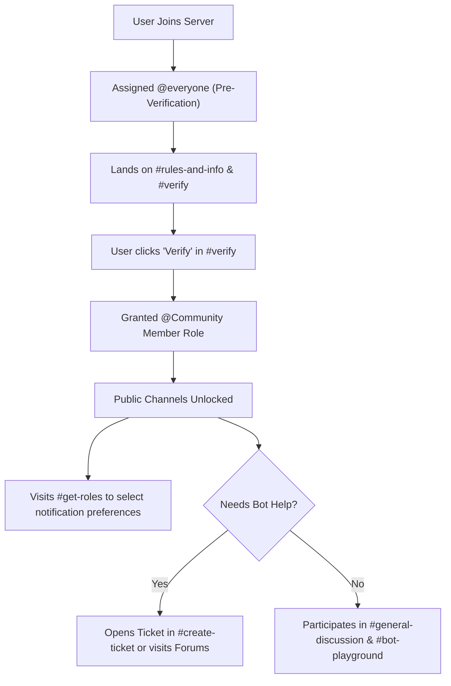

# 🛡️ Official Aegis Support Discord Server — Architecture & Setup Blueprint

> Complete blueprint and administrative manual for creating and configuring the official **Aegis Support & Community Discord Server**. This document specifies the complete hierarchy of roles, channels, categories, permission overrides, automations, and bot integrations.

---

## Table of Contents

1. [Server Foundation & Community Settings](#1-server-foundation--community-settings)
2. [Role Hierarchy & Specifications](#2-role-hierarchy--specifications)
3. [Global Permissions Matrix](#3-global-permissions-matrix)
4. [Category & Channel Architecture](#4-category--channel-architecture)
5. [Channel Reference & Descriptions](#5-channel-reference--descriptions)
6. [Channel Permissions Breakdown](#6-channel-permissions-breakdown)
7. [Official Aegis Bot Setup & Integration](#7-official-aegis-bot-setup--integration)
8. [Onboarding & Member Journey](#8-onboarding--member-journey)
9. [Staff Standard Operating Procedures (SOP)](#9-staff-standard-operating-procedures-sop)
10. [Pre-Launch QA Checklist](#10-pre-launch-qa-checklist)

---

## 1. Server Foundation & Community Settings

### Server Metadata
- **Server Name:** `Aegis Support & Community`
- **Server Region:** Preferred closest to main bot host (US East / Central)
- **Community Enabled:** Yes (Required for Announcement channels, Forum channels, Welcome screen, and Server Insights)
- **Description:** *Official support, development updates, documentation, and community server for the Aegis Discord moderation and management bot.*

### Safety & Moderation Setup
- **Verification Level:** `High` (Must be a member of the server for longer than 10 minutes)
- **Explicit Media Content Filter:** `Scan media content from all members`
- **Default Notification Settings:** `Only @mentions`
- **2FA Requirement for Moderation:** `Enabled` (All staff roles with administrative/kick/ban powers must have 2FA enabled)

---

## 2. Role Hierarchy & Specifications

Roles must be arranged in the exact order shown below (highest position first) to preserve permission and moderation role hierarchy.

| Position | Role Name | Color Hex | Hoist | Mentionable | Purpose & Qualifications |
|:---:|---|---|:---:|:---:|---|
| **1** | `Founder / Owner` | `#E74C3C` (Ruby Red) | Yes | No | Server owner & core creator. Unrestricted administrative control. |
| **2** | `Lead Developer` | `#9B59B6` (Purple) | Yes | Yes | Core bot software engineers & infrastructure managers. |
| **3** | `Head Moderator` | `#E67E22` (Orange) | Yes | Yes | Leads moderation team, handles escalations, oversees staff actions. |
| **4** | `Moderator` | `#3498DB` (Cyan Blue) | Yes | Yes | Daily community moderation, chat management, purge/mute/warn enforcement. |
| **5** | `Support Specialist` | `#2ECC71` (Emerald) | Yes | Yes | Official technical support staff answering tickets and community questions. |
| **6** | `Aegis Bot` | `#5865F2` (Blurple) | Yes | Yes | The official production Aegis bot instance. Elevated permissions. |
| **7** | `System Bots` | `#7289DA` (Steel Blue) | Yes | No | Auxiliary utility bots (GitHub webhooks, uptime monitor, audio test). |
| **8** | `Contributor / Dev` | `#1ABC9C` (Turquoise) | Yes | No | Open-source contributors with accepted PRs or code contributions. |
| **9** | `Bug Hunter` | `#F1C40F` (Gold) | Yes | No | Members who discover and verify critical bugs or security flaws. |
| **10** | `Server Booster` | `#F47FFF` (Nitro Pink) | Yes | No | Nitro boosters supporting the community (auto-managed by Discord). |
| **11** | `VIP / Partner` | `#E91E63` (Magenta) | Yes | No | Verified server owners running Aegis in 1,000+ member guilds or sponsors. |
| **12** | `Active Member` | `#6782B4` (Slate Blue) | No | No | Established active community members rewarded for engagement. |
| **13** | `Community Member` | `#95A5A6` (Light Gray) | No | No | Verified standard member role. Baseline access to public channels. |
| **14** | `Announcement Ping` | `#A0B0C0` (Muted) | No | No | Opt-in role for major release announcements. |
| **15** | `Bot Updates Ping` | `#A0B0C0` (Muted) | No | No | Opt-in role for patch notes, feature updates, and changelogs. |
| **16** | `Outage / Status Ping` | `#A0B0C0` (Muted) | No | No | Opt-in role for maintenance notices and downtime alerts. |
| **17** | `Muted / Quarantine` | `#4F545C` (Dark Gray) | No | No | Restricted role for members placed in cooldown or under investigation. |
| **18** | `@everyone` | None | No | No | Baseline pre-verification role. Restricted read-only view of landing channels. |

---

## 3. Global Permissions Matrix

| Role | Admin | Manage Guild | Manage Roles | Manage Chans | Kick / Ban | Timeout | Mod Messages | View Audit | Send Messages |
|---|:---:|:---:|:---:|:---:|:---:|:---:|:---:|:---:|:---:|
| `Founder / Owner` | ✅ | ✅ | ✅ | ✅ | ✅ | ✅ | ✅ | ✅ | ✅ |
| `Lead Developer` | ✅ | ✅ | ✅ | ✅ | ✅ | ✅ | ✅ | ✅ | ✅ |
| `Head Moderator` | ❌ | ✅ | ✅ | ✅ | ✅ | ✅ | ✅ | ✅ | ✅ |
| `Moderator` | ❌ | ❌ | ❌ | ❌ | ✅ | ✅ | ✅ | ✅ | ✅ |
| `Support Specialist` | ❌ | ❌ | ❌ | ❌ | ❌ | ✅ | ✅ | ❌ | ✅ |
| `Aegis Bot` | ❌ | ✅ | ✅ | ✅ | ✅ | ✅ | ✅ | ✅ | ✅ |
| `System Bots` | ❌ | ❌ | ❌ | ❌ | ❌ | ❌ | ❌ | ❌ | ✅ |
| `Community Member` | ❌ | ❌ | ❌ | ❌ | ❌ | ❌ | ❌ | ❌ | ✅ |
| `Muted / Quarantine` | ❌ | ❌ | ❌ | ❌ | ❌ | ❌ | ❌ | ❌ | ❌ |
| `@everyone` | ❌ | ❌ | ❌ | ❌ | ❌ | ❌ | ❌ | ❌ | ❌ |

---

## 4. Category & Channel Architecture

```
📂 ─── 📌 INFORMATION & WELCOME ───
  ├─ 📜・rules-and-info        [Text | Read-only]
  ├─ 👋・welcome               [Text | Read-only | Aegis welcome target]
  ├─ 📢・announcements         [Announcement | Read-only]
  ├─ 🚀・bot-updates           [Announcement | Read-only]
  ├─ 📊・status-and-outages     [Announcement | Read-only]
  └─ 🔗・official-links        [Text | Read-only]

📂 ─── 🛡️ VERIFICATION & ROLES ───
  ├─ ⚡・verify                [Text | Interactive Verification Panel]
  └─ 🎭・get-roles             [Text | Interactive Role Selection Panel]

📂 ─── 💬 COMMUNITY CHAT ───
  ├─ 💬・general-discussion    [Text | Slowmode 3s]
  ├─ 🤖・bot-discussion        [Text | Slowmode 5s]
  ├─ 🛠️・showcase-setups       [Text | Slowmode 15s]
  ├─ ⭐・highlights            [Text | Starboard feed]
  └─ 📸・media-and-memes       [Text | Slowmode 10s]

📂 ─── 🧪 TESTING & PLAYGROUND ───
  ├─ 🤖・bot-playground-1      [Text | Public bot command testing]
  ├─ 🤖・bot-playground-2      [Text | Public bot command testing]
  └─ 🔐・mod-commands-testing  [Text | Staff-only command testing]

📂 ─── 🎫 SUPPORT & TICKETS ───
  ├─ 📩・create-ticket         [Text | Support ticket launcher panel]
  ├─ ❓・faq-quick-help        [Text | Read-only searchable FAQ]
  ├─ 💻・self-hosting          [Forum | Docker, Fly.io, MongoDB support]
  └─ 🔌・api-and-dev-help      [Forum | Developer and integration help]

📂 ─── 💡 FEEDBACK & BUGS ───
  ├─ 💡・suggestions           [Text | Interactive suggestion system via /suggest]
  └─ 🐛・bug-reports           [Forum | Structured bug tracking with status tags]

📂 ─── 🔒 STAFF COMMAND & AUDIT ───
  ├─ 💬・staff-chat            [Text | Private staff discussion]
  ├─ 📋・mod-logs              [Text | Bot audit log: bans, warns, kicks, purges]
  ├─ 🚨・watchlist-alerts      [Text | Aegis real-time alerts for watched users]
  ├─ 📑・ticket-transcripts    [Text | HTML ticket closing archives]
  └─ 🤖・bot-debug-logs        [Text | System exceptions, alerts, deployment notices]

📂 ─── 🔊 VOICE LOUNGES ───
  ├─ 🎙️・Community Lounge      [Voice | Bitrate 64kbps | User limit 25]
  ├─ 🎮・Gaming & Screen Share [Voice | Bitrate 96kbps | User limit 10]
  ├─ 🔒・Staff Meeting Room    [Voice | Bitrate 96kbps | Staff-only]
  └─ 💤・AFK                   [Voice | Inactive channel 15m timeout]
```

---

## 5. Channel Reference & Descriptions

Every channel has a single job. If a conversation does not fit the "What it is for" line below, move it to the linked channel instead of stretching the topic.

The **Suggested topic** column is written to paste straight into Discord's *Edit Channel → Topic* field. Topics are short on purpose: they show in the channel header and in search results.

### 5.1 📌 Information & Welcome

| Channel | Who can post | What it is for | Aegis behavior | Suggested topic |
|---|---|---|---|---|
| `#rules-and-info` | Staff only (`@everyone` reads) | The canonical rules, the warning/escalation ladder, and the map of where to get help. This is the one page every member is expected to read. | Pinned rule embed. No automod needed because nobody can post. | `Read first: server rules, the warning ladder, and where to get help. Then verify in #verify.` |
| `#welcome` | Aegis only (`@everyone` reads) | Landing feed for new members. Greets each join and points to the next step: read the rules, then verify. | `/welcome` posts here using `{user}`, `{server}`, and `{member_count}`. | `Welcome to Aegis Support & Community! Read #rules-and-info, then click Verify in #verify.` |
| `#announcements` | Staff only (`@everyone` reads) | High-signal news: major releases, events, policy changes, and community milestones. Published to followers. | `/announce` with `crosspost:true` publishes to the channel's followers. | `Major Aegis releases, events, and community news. Reactions on, replies off — discuss in #general-discussion.` |
| `#bot-updates` | Staff only (`@everyone` reads) | Every version bump: new commands, changed options, fixes, and deprecations. Lower volume than announcements, higher detail. | `/announce` or `/embed`; each post should link the matching entry on the site's changelog page (`aegisdeno.fly.dev/changelog`). | `Release notes for every Aegis version: new commands, fixes, and breaking changes.` |
| `#status-and-outages` | Staff only (`@everyone` reads) | Incident notices: planned maintenance, gateway problems, degraded performance, and all-clears. | Manual posts; always include a link to the status page (`aegisdeno.fly.dev/status`) so members can check live numbers. | `Incident and maintenance notices. Check the live status page before reporting downtime.` |
| `#official-links` | Staff only (`@everyone` reads) | One message with every trusted destination: invite, dashboard, docs, status, changelog, support, and legal pages. | Pinned embed. This is the only place invite links should be posted. | `Official Aegis links: invite, dashboard, docs, status, changelog, and support. Nothing else here.` |

> **Why `#welcome` exists:** the welcome system needs a dedicated target. Posting greetings in `#rules-and-info` buries the rules and breaks the "read-only reference" role of that channel.

### 5.2 🛡️ Verification & Roles

| Channel | Who can post | What it is for | Aegis behavior | Suggested topic |
|---|---|---|---|---|
| `#verify` | Aegis only; `@everyone` can view and click the button | The single gate between a join and the community. Holds the verification panel only. | `/verify setup` posts the panel, grants `@Community Member`, and hides `#verify` from verified members. Optional auto-kick removes members who never verify. | `Click Verify to unlock the server. One click, no forms. Already verified? This channel hides itself.` |
| `#get-roles` | Aegis only; `@Community Member` reads | Opt-in notification roles. Members choose which pings they want without asking staff. | `/rolepanel create` posts a dropdown or button panel. Selecting a role adds it; deselecting removes it. | `Pick your notification roles: release pings, bot update pings, and outage alerts. Change them anytime.` |

### 5.3 💬 Community Chat

| Channel | Who can post | What it is for | Aegis behavior | Suggested topic |
|---|---|---|---|---|
| `#general-discussion` | `@Community Member` (3s slowmode) | Day-to-day conversation about Aegis, Discord servers, moderation, and anything community-related. The default room. | AutoMod applies (links, mentions, spam, caps). No file uploads here — send media to `#media-and-memes`. | `General chat for the Aegis community. Be kind, stay on topic, and open a ticket for account-specific help.` |
| `#bot-discussion` | `@Community Member` (5s slowmode) | Feature questions, configuration ideas, and "how would I set up…" threads that are useful to everyone. | AutoMod applies. Support staff watch this channel; no ticket needed for general questions. | `Talk about Aegis features and configuration. For private logs or account issues, open a ticket.` |
| `#showcase-setups` | `@Community Member` (15s slowmode) | Screenshots and walkthroughs of real server setups: logging layouts, automod rules, ticket flows, role panels. | AutoMod allows attachments here. Reactions encouraged; no starboard. | `Show your Aegis setup: logging layouts, automod rules, ticket flows, and role panels. Screenshots welcome.` |
| `#highlights` | Aegis only (`@Community Member` reads) | Curated community highlights. Messages that reach the star threshold appear here automatically. | Starboard: ⭐ ×4 promotes a message. Self-stars do not count. Staff can remove an entry. | `Community highlights, chosen by reactions. Star a message in chat with ⭐ to nominate it.` |
| `#media-and-memes` | `@Community Member` (10s slowmode) | Images, clips, and light off-topic fun. The pressure valve for the server. | AutoMod allows attachments; spam and caps filters still apply. | `Images, clips, and memes. Keep it safe for work and keep support questions in the support channels.` |

### 5.4 🧪 Testing & Playground

| Channel | Who can post | What it is for | Aegis behavior | Suggested topic |
|---|---|---|---|---|
| `#bot-playground-1` | `@Community Member` (3s slowmode) | Try commands before using them for real: `/poll`, `/remindme`, `/help`, `/ping`, `/serverinfo`. | AutoMod exemptions are configured here, so link and spam tests do not trip the filters. Messages may be purged periodically. | `Test Aegis commands here. Try /poll, /remindme, /help, and /serverinfo. Do not run moderation commands.` |
| `#bot-playground-2` | `@Community Member` (3s slowmode) | Overflow for playground 1 during busy periods, and a second sandbox for multi-user tests. | Same exemptions and cleanup as playground 1. | `Second command sandbox for busy periods and multi-user tests. Same rules as #bot-playground-1.` |
| `#mod-commands-testing` | Staff only | Rehearse moderation flows without touching real members: warnings, timeouts, case edits, purge filters, and escalation thresholds. | Full logging and case creation still run here, so staff can verify the audit trail. Use a dedicated test account. | `Staff-only sandbox for moderation commands. Use a test account; real cases and logs are created here.` |

### 5.5 🎫 Support & Tickets

| Channel | Who can post | What it is for | Aegis behavior | Suggested topic |
|---|---|---|---|---|
| `#create-ticket` | Aegis only; `@Community Member` reads | The only supported way to open a private ticket. One persistent panel, no chatter. | `/ticket setup` posts the panel. The button creates a private channel, pings the support role, and logs the ticket. | `Open a private support ticket. Use this for logs, account issues, and anything you cannot share publicly.` |
| `#faq-quick-help` | Staff only (`@Community Member` reads) | The ten questions that answer themselves: invite permissions, missing slash commands, resetting config, transcript access, appeal codes. | Pinned FAQ embed. Each answer ends with a link to the matching section of the docs page (`aegisdeno.fly.dev/docs`). | `Quick answers to the most common Aegis questions. Search here before opening a ticket.` |
| `#self-hosting` | `@Community Member` (forum, 5s per thread) | Long-form help for running Aegis yourself: Docker, Fly.io, MongoDB, Node.js, environment variables, and first boot. | Forum threads. Tags: `Docker`, `Fly.io`, `MongoDB`, `Node.js`, `Solved`, `Investigating`. Auto-archive after 7 days idle. | `Self-hosting help: Docker, Fly.io, MongoDB, Node.js, and environment setup. One issue per thread.` |
| `#api-and-dev-help` | `@Community Member` (forum, 5s per thread) | Integration questions: webhooks, dashboards, custom tooling, and API-shaped work around Aegis. | Forum threads. Tags: `API`, `Webhooks`, `Bots`, `Solved`, `Investigating`. Auto-archive after 7 days idle. | `Developer help for Aegis integrations, webhooks, and custom tooling. One question per thread.` |

> Account-specific details (tokens, IPs, private logs, billing) never belong in a public forum. Route those to a ticket.

### 5.6 💡 Feedback & Bugs

| Channel | Who can post | What it is for | Aegis behavior | Suggested topic |
|---|---|---|---|---|
| `#suggestions` | `@Community Member` via `/suggest` | Product feedback: new commands, workflow changes, dashboard ideas. One idea per message so votes stay meaningful. | `/suggest submit` posts an embed with vote buttons. Staff move it through `consider`, `approve`, or `deny` with a public reason. | `Suggest Aegis features with /suggest. One idea per message. Staff reply with a decision and a reason.` |
| `#bug-reports` | `@Community Member` (forum) | Reproducible bugs with steps, expected vs. actual behavior, and version. Not for outages. | Forum threads with status tags. Staff ask for logs, confirm, and tag `Fixed` when a release lands. | `Report a reproducible Aegis bug: steps, expected result, actual result, and version. Outages go to #status-and-outages.` |

### 5.7 🔒 Staff Command & Audit

| Channel | Who can post | What it is for | Aegis behavior | Suggested topic |
|---|---|---|---|---|
| `#staff-chat` | Staff only | Coordination, handoffs, escalations, and decisions that should not be public. The default staff room. | No automod. Keep unresolved cases linked to their case ID. | `Staff coordination, handoffs, and escalation notes. Link the case ID when discussing a member.` |
| `#mod-logs` | Aegis + staff (read-only for staff) | The audit trail: warnings, timeouts, kicks, bans, unbans, purges, case edits, and revocations. | Aegis posts one embed per action, with moderator, target, reason, duration, and case ID. | `Aegis moderation audit log. Read-only. Every action links back to its case.` |
| `#watchlist-alerts` | Aegis + staff | Real-time Ghost Watch alerts for watched members: messages, edits, deletes, joins, leaves, and role changes. | `/watchlist add` targets a member; alerts post here and DM the watcher. Private-channel text is redacted in the staff copy. | `Ghost Watch alerts for watched members. Alerts are confidential; do not quote them in public channels.` |
| `#ticket-transcripts` | Aegis + staff | Permanent HTML transcripts for every closed ticket, including who opened it, who claimed it, and the close reason. | `/ticket settings log_channel` sends the transcript here on close. | `Closed ticket transcripts. Search by ticket number or member before reopening a discussion.` |
| `#bot-debug-logs` | Aegis + staff | Operational signal: failed actions, scheduler retries, automod errors, deploy notices, and permission regressions. | Aegis posts exceptions and recovery notices. Not a place for member reports. | `Aegis runtime errors, failed actions, and deployment notices. Include the timestamp when reporting.` |

### 5.8 🔊 Voice Lounges

Voice channels do not have topics. Set the channel **status** shown below instead, and pin etiquette in the text channel of the same name if one is added later.

| Channel | Access | What it is for | Suggested channel status |
|---|---|---|---|
| `🎙️ Community Lounge` | `@Community Member` · 64kbps · limit 25 | Casual voice chat, co-working, and drop-in conversation. | `Chill voice chat · 25 max · no music spam` |
| `🎮 Gaming & Screen Share` | `@Community Member` · 96kbps · limit 10 | Game nights, screen shares, and watch parties. Higher bitrate for video. | `Games and screen share · 10 max · ask before streaming` |
| `🔒 Staff Meeting Room` | Staff only · 96kbps | Private staff calls, incident reviews, and planning. | `Staff meetings only` |
| `💤 AFK` | `@Community Member` | Parking channel. Discord moves idle members here after 15 minutes. | `AFK · auto-moved after 15 minutes` |

### 5.9 Channel Conventions

- **Name format:** `emoji・kebab-case`. Lowercase, hyphens, no spaces. Voice channels may use title case because they read as room names.
- **Category order:** Information → Verification → Community → Testing → Support → Feedback → Staff → Voice. New public channels go above Staff; staff channels never move above public ones.
- **Topics are documentation:** every text channel gets a topic written in the imperative ("Report…", "Ask…", "Show…"). If a channel's topic needs two sentences to explain, split the channel.
- **Slowmode is a tool, not a punishment:** 3s for general chat, 5s for discussion and forums, 10–15s for media and showcases. Never set slowmode on read-only or staff channels.
- **Read-only means read-only:** information, verification, and transcript channels deny `Send Messages` for `@everyone` and `@Community Member`. Staff post through Aegis or with an explicit override.
- **Archive, don't delete:** forum threads auto-archive after 7 days. Public channels are renamed or archived rather than deleted, so old links keep working.
- **One bot per job:** Aegis owns moderation, tickets, verification, role panels, starboard, and logging. System bots own webhooks and uptime. Do not let two bots post the same event.

### 5.10 What Aegis Posts Where

| Aegis event | Destination | Trigger |
|---|---|---|
| Warnings, timeouts, kicks, bans, unbans, purges | `#mod-logs` | `/warn`, `/timeout`, `/kick`, `/ban`, `/unban`, `/purge` |
| Case edits and revocations | `#mod-logs` | `/case edit`, `/case delete`, dashboard revoke |
| Ghost Watch alerts | `#watchlist-alerts` + watcher DMs | `/watchlist add` |
| Ticket open, claim, close, transcript | Ticket channel + `#ticket-transcripts` | `/ticket setup`, panel button, `/ticket close` |
| Verification grant or auto-kick | `#mod-logs` (member events) + `#verify` | `/verify setup`, panel button |
| Starboard promotions and removals | `#highlights` | ⭐ reactions |
| Suggestions and decisions | `#suggestions` | `/suggest submit`, `/suggest approve` |
| Welcome messages | `#welcome` | Member join |
| Runtime errors and deploy notices | `#bot-debug-logs` | Internal logger |
| Status changes | `#status-and-outages` | Staff post; links the status page (`aegisdeno.fly.dev/status`) |

---

## 6. Channel Permissions Breakdown

### 6.1 Category: `📌 INFORMATION & WELCOME`
- **Target Audience:** Public broadcast to all joined users.
- **`@everyone` Overrides:**
  - `View Channel`: ✅ Allow
  - `Send Messages`: ❌ Deny
  - `Add Reactions`: ✅ Allow
  - `Create Public/Private Threads`: ❌ Deny
- **Staff / Bot Overrides:**
  - `Lead Developer` / `Moderator`: `Send Messages`: ✅ Allow
  - `Aegis Bot`: `Send Messages`, `Embed Links`, `Attach Files`: ✅ Allow

### 6.2 Category: `🛡️ VERIFICATION & ROLES`
- **`#verify`:**
  - **`@everyone`:** `View Channel`: ✅ Allow, `Send Messages`: ❌ Deny, `Read Message History`: ✅ Allow.
  - **`Community Member`:** `View Channel`: ❌ Deny (hidden once verified so the channel list stays clean).
  - **`Aegis Bot`:** Full message, embed, button interaction permissions.
- **`#get-roles`:**
  - **`@everyone`:** `View Channel`: ❌ Deny.
  - **`Community Member`:** `View Channel`: ✅ Allow, `Send Messages`: ❌ Deny, `Read Message History`: ✅ Allow.
  - Contains the Aegis `/rolepanel` dropdown for opt-in ping roles.

### 6.3 Category: `💬 COMMUNITY CHAT`
- **`@everyone`:** `View Channel`: ❌ Deny (Must be verified).
- **`Community Member`:**
  - `View Channel`: ✅ Allow
  - `Send Messages`: ✅ Allow
  - `Attach Files`: ✅ Allow (Denied in `#general-discussion`, allowed in `#media-and-memes` and `#showcase-setups`)
  - `Embed Links`: ✅ Allow (Subject to Aegis Automod URL filters)
  - `Mention @everyone / @here`: ❌ Deny
- **`Muted / Quarantine`:**
  - `Send Messages`: ❌ Deny
  - `Add Reactions`: ❌ Deny

### 6.4 Category: `🧪 TESTING & PLAYGROUND`
- **Purpose:** Where community members can test `/ping`, `/help`, `/remindme`, `/poll`, and preview Aegis features without cluttering general chat.
- **`#bot-playground-1` & `2`:**
  - Rate limit slowmode: `3 seconds`
  - Message auto-cleanup: Regular purge or a pinned notice explaining testing etiquette.
  - AutoMod exemptions: `addchannel` for both playgrounds so filter tests do not punish testers.
- **`#mod-commands-testing`:**
  - Viewable only by `Support Specialist`, `Moderator`, `Lead Developer`.
  - Use a dedicated test account so real members are never targeted.

### 6.5 Category: `🎫 SUPPORT & TICKETS`
- **`#create-ticket`:**
  - **`Community Member`:** `View Channel`: ✅ Allow, `Send Messages`: ❌ Deny. Contains the persistent ticket launcher embed.
- **Individual Ticket Channels (`ticket-XXXX` created dynamically):**
  - Inherits staff permissions.
  - Ticket creator: `View Channel`: ✅ Allow, `Send Messages`: ✅ Allow, `Attach Files`: ✅ Allow.
  - `@everyone`: `View Channel`: ❌ Deny.
- **`#self-hosting` & `#api-and-dev-help` (Forum Channels):**
  - Available tags: `[Docker]`, `[Fly.io]`, `[MongoDB]`, `[Node.js]`, `[API]`, `[Webhooks]`, `[Solved]`, `[Investigating]`.
  - Slowmode per thread: 5s.
  - Require a tag before posting so threads can be filtered.

### 6.6 Category: `🔒 STAFF COMMAND & AUDIT`
- **`@everyone` & `Community Member`:** `View Channel`: ❌ Deny.
- **`Moderator`, `Head Moderator`, `Lead Developer`, `Support Specialist`:** `View Channel`: ✅ Allow with `Send Messages` only where the channel is not read-only.
- **`Aegis Bot`:** `Send Messages`, `Embed Links`, `Attach Files` enabled for logging pipelines.
- **Channel-specific locks:**
  - `#mod-logs`, `#watchlist-alerts`, `#ticket-transcripts`, `#bot-debug-logs`: staff `Send Messages` ❌ Deny. Aegis posts; staff read.
  - `#staff-chat`: staff `Send Messages` ✅ Allow.

---

## 7. Official Aegis Bot Setup & Integration

Run the following commands inside the server using the bot to configure its native subsystems. Option names below match the registered slash commands; if a command changes, `/help` and the public command catalog (`aegisdeno.fly.dev/commands`) are the source of truth.

### 7.1 Setup Order

1. **Invite Aegis** with the `bot` and `applications.commands` scopes.
2. **Run `/diagnostics`** and fix every missing permission before continuing. Aegis needs `View Channels`, `Send Messages`, `Embed Links`, `Attach Files`, `Read Message History`, `Manage Messages`, `Moderate Members`, `Kick Members`, `Ban Members`, `Manage Channels`, and `Manage Roles`.
3. **Set language and logging** (7.2).
4. **Post the verification panel** (7.3).
5. **Post the role panel** (7.4).
6. **Configure suggestions, tickets, and welcome** (7.5–7.7).
7. **Configure Automod and escalation** (7.9–7.10).
8. **Configure the starboard** (7.8).
9. **Test everything** with the pre-launch checklist in §10.

### 7.2 General & Audit Logging Setup

```bash
/config language language:English (en)

/logging channel channel:#mod-logs
/logging toggle enabled:true
/logging status
/logging test
```

`/logging status` opens the interactive category manager. Use the buttons to toggle mod actions, member joins/leaves, message edits/deletes, role changes, and channel events. There is no `/logging categories` subcommand — the buttons replace it.

### 7.3 Verification Gate

```bash
/verify setup channel:#verify verified_role:@Community Member type:One-Click Button kick_unverified_minutes:30
```

- `type:One-Click Button` is the one-click panel. Use `type:CAPTCHA Verification` if the server is under active raid pressure.
- `kick_unverified_minutes:0` disables auto-kick. Change it later with `/verify autokick minutes:30`.
- `/verify user target:@member` manually verifies a member; `/verify batch` handles a trusted list; `/verify info` shows current settings.

### 7.4 Role Selection Panels (Opt-In Pings)

```bash
/rolepanel create channel:#get-roles role1:@Announcement Ping role2:@Bot Updates Ping role3:@Outage / Status Ping style:Dropdown menu exclusive:false
```

- `style:Buttons` is the default. `style:Dropdown menu` is better for three or more roles.
- `exclusive:true` lets a member hold only one role from the panel; keep `false` for independent notification pings.
- Add `required_role:@Community Member` if the panel should stay gated.
- Inspect or remove panels with `/rolepanel list` and `/rolepanel delete id:<panel-id>`.

### 7.5 Support Ticket Launcher & Settings

```bash
/ticket settings log_channel:#ticket-transcripts autoclose_hours:48 transcripts:true

/ticket setup channel:#create-ticket staff_role:@Support Specialist title:"Aegis Technical Support" description:"Click the button below to open a private support ticket with our engineering and support staff."
```

- `autoclose_hours:0` turns inactivity closing off.
- `transcripts:false` keeps transcripts out of the log channel while still DMing the member.
- `/ticket claim`, `/ticket add`, `/ticket remove`, `/ticket rename`, `/ticket transcript`, and `/ticket close` are used inside the ticket channel.

### 7.6 Welcome & Orientation

```bash
/welcome channel channel:#welcome
/welcome message
/welcome toggle enabled:true
/welcome preview
```

`/welcome message` opens a form rather than taking the text as an option. Paste this into the form, replacing `RULES_CHANNEL_ID` and `VERIFY_CHANNEL_ID` with the real channel IDs:

```text
Welcome {user} to the official **{server}**! Please read <#RULES_CHANNEL_ID> and then verify in <#VERIFY_CHANNEL_ID>. You are member #{count}.
```

Supported variables: `{user}` mentions the member, `{username}` is their display name without a mention, `{server}` is the server name, and `{count}` is the member count. `{member_count}` is kept as an alias. `/welcome preview` renders the message exactly as members will see it before you enable it.

### 7.7 Suggestions

```bash
/suggest setup channel:#suggestions
```

Members submit with `/suggest submit`. Staff triage with `/suggest consider`, `/suggest approve`, and `/suggest deny`, each with an optional public `reason`. `/suggest info id:<id>` shows the full review history.

### 7.8 Starboard Highlights

```bash
/starboard setup channel:#highlights
/starboard threshold count:4
/starboard emoji emoji:⭐
/starboard selfstar allowed:false
/starboard toggle enabled:true
```

- Star a message with ⭐ to nominate it. At four reactions it is copied to `#highlights`.
- `/starboard ignore action:add channel:#media-and-memes` keeps noisy channels out.
- `/starboard config` and `/starboard list` verify the setup.

### 7.9 Automod & Spam Protection

```bash
# Link protection for non-staff
/automod links toggle enabled:true
/automod links action action:Delete message

# Mention spam safeguard
/automod mentions toggle enabled:true
/automod mentions limit count:5
/automod mentions action action:Delete and timeout

# Chat flooding / raid spam defense
/automod spam toggle enabled:true
/automod spam limit max:5 window:4
/automod spam action action:Delete and timeout

# Excessive caps (useful in general chat)
/automod caps toggle enabled:true
/automod caps limit percent:80
/automod caps action action:Delete message

# Whitelist staff and test channels
/automod exempt addrole role:@Support Specialist
/automod exempt addrole role:@Moderator
/automod exempt addchannel channel:#bot-playground-1
/automod exempt addchannel channel:#bot-playground-2

/automod status
```

Each filter's `action` accepts `delete`, `warn`, or `timeout`. `/automod status` shows the full picture, including exemptions.

### 7.10 Escalation Safety Nets

```bash
/escalation toggle enabled:true
/escalation add warnings:3 action:Timeout duration:60
/escalation add warnings:5 action:Timeout duration:1440
/escalation add warnings:7 action:Ban
/escalation expiry days:30
/escalation status
```

`duration` is in minutes and only applies to the `timeout` action. `expiry days:0` makes warnings count forever.

### 7.11 Post-Setup Verification

```bash
/diagnostics
/logging test
/verify info
/ticket settings
/starboard config
/automod status
/escalation status
```

---

## 8. Onboarding & Member Journey



1. **Arrival:** New member joins, sees only `#rules-and-info`, `#welcome`, `#announcements`, `#status-and-outages`, and `#verify`.
2. **Verification:** Member reviews the rules and clicks the button in `#verify`.
3. **Role Assignment:** Aegis grants `@Community Member` and automatically hides `#verify`.
4. **Notification Setup:** Member visits `#get-roles` and selects opt-in pings (release notices, bot updates, outages).
5. **Support Interaction:** If seeking assistance, member opens a structured thread in `#self-hosting` / `#api-and-dev-help` or clicks **Create Ticket** for sensitive inquiries (billing, credentials, private logs).

---

## 9. Staff Standard Operating Procedures (SOP)

### Incident & Escalation Flow
- **Minor Infraction (Excessive Caps, Off-topic, Light spam):**
  - Verbal redirect in channel or `/warn user:@member reason:"Off-topic flooding" severity:low`
- **Moderate Infraction (Disrespect, NSFW link attempt, Toxic behavior):**
  - `/warn user:@member reason:"Harassment or toxic behavior" severity:medium`
  - If repeat behavior occurs within 10 minutes: `/timeout user:@member duration:10m reason:"Cool down"`
- **Severe Infraction (Malicious links, Token grabber, Extreme hate speech, Raid):**
  - Immediate `/ban user:@member delete_messages:7 reason:"Malicious compromise / link distribution" proof:<attachment>`
  - If a channel is under active raid flood:
    - `/lock channel duration_minutes:15 reason:"Raid containment in progress"`
    - Run `/purge amount:100 filter:links` or `/purge amount:200 filter:bots`

### Ticket Resolution Etiquette
1. **Claiming:** Staff members must press **Claim** on the ticket embed (`/ticket claim`) before providing in-depth support to avoid duplicate staff intervention.
2. **Diagnostics:** When troubleshooting user instances, direct them to run `/diagnostics` and provide non-sensitive logs. Never ask for bot tokens or database passwords.
3. **Closing:** When resolved, notify the user and invoke `/ticket close reason:"Issue resolved after configuration update"`. The bot automatically generates an HTML transcript and sends it to `#ticket-transcripts`.

### Case Hygiene
- Every action gets a reason. "No reason provided" is not an audit trail.
- Use `/case edit case_id:<id> reason:"…"` when new context appears; do not delete a case to hide a mistake.
- Link the case ID in `#staff-chat` when escalating so the next moderator can read the history.
- Use `/note add user:@member` for context that should not count toward warnings.

---

## 10. Pre-Launch QA Checklist

- [ ] Aegis is online and `/diagnostics` reports no missing permissions.
- [ ] `/logging test` lands in `#mod-logs`.
- [ ] A test warning appears in `#mod-logs` with a case ID and a working case link.
- [ ] `#verify` grants `@Community Member` and hides itself afterward.
- [ ] Auto-kick works on a test account (or is intentionally disabled).
- [ ] `#get-roles` adds and removes each opt-in role.
- [ ] A test ticket opens, pings `@Support Specialist`, claims, and closes.
- [ ] The closed ticket transcript lands in `#ticket-transcripts`.
- [ ] A join posts a welcome message in `#welcome` with the correct member count.
- [ ] A starred message reaches `#highlights` after the threshold.
- [ ] `/suggest submit` posts in `#suggestions`; approve and deny both update the embed.
- [ ] AutoMod deletes a test link and a test mention flood, but not in the playground channels.
- [ ] Escalation fires at the configured warning threshold.
- [ ] Announcement channels are published/crossposted correctly.
- [ ] `@everyone` cannot post in read-only channels and cannot see staff channels.
- [ ] Forum tags exist and posting requires a tag.
- [ ] Invite, dashboard, docs, status, and changelog links in `#official-links` all resolve.

---

*Document version: 3.7.0 · Maintained by Aegis Development Team.*
