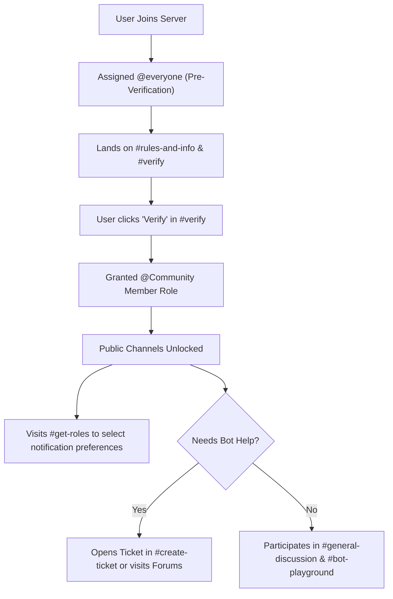

# 🛡️ Official Aegis Support Discord Server — Architecture & Setup Blueprint

> Complete blueprint and administrative manual for creating and configuring the official **Aegis Support & Community Discord Server**. This document specifies the complete hierarchy of roles, channels, categories, permission overrides, automations, and bot integrations.

---

## Table of Contents

1. [Server Foundation & Community Settings](#1-server-foundation--community-settings)
2. [Role Hierarchy & Specifications](#2-role-hierarchy--specifications)
3. [Global Permissions Matrix](#3-global-permissions-matrix)
4. [Category & Channel Architecture](#4-category--channel-architecture)
5. [Channel Permissions Breakdown](#5-channel-permissions-breakdown)
6. [Official Aegis Bot Setup & Integration](#6-official-aegis-bot-setup--integration)
7. [Onboarding & Member Journey](#7-onboarding--member-journey)
8. [Staff Standard Operating Procedures (SOP)](#8-staff-standard-operating-procedures-sop)

---

## 1. Server Foundation & Community Settings

### Server Metadata
- **Server Name:** `Aegis Support & Community`
- **Server Region:** Preferred closest to main bot host (US East / Central)
- **Community Enabled:** Yes (Required for Announcement channels, Forum channels, Welcome screen, and Server Insights)
- **Description:** *Official support, development updates, documentation, and community server for the Aegis Discord moderation and management bot.*

### Safety & Moderation Setup
- **Verification Level:** `High` (Must be a member of the server for longer than 10 minutes)
- **Explicit Media Content Filter:** `Scan media content from all members`
- **Default Notification Settings:** `Only @mentions`
- **2FA Requirement for Moderation:** `Enabled` (All staff roles with administrative/kick/ban powers must have 2FA enabled)

---

## 2. Role Hierarchy & Specifications

Roles must be arranged in the exact order shown below (highest position first) to preserve permission and moderation role hierarchy.

| Position | Role Name | Color Hex | Hoist | Mentionable | Purpose & Qualifications |
|:---:|---|---|:---:|:---:|---|
| **1** | `Founder / Owner` | `#E74C3C` (Ruby Red) | Yes | No | Server owner & core creator. Unrestricted administrative control. |
| **2** | `Lead Developer` | `#9B59B6` (Purple) | Yes | Yes | Core bot software engineers & infrastructure managers. |
| **3** | `Head Moderator` | `#E67E22` (Orange) | Yes | Yes | Leads moderation team, handles escalations, oversees staff actions. |
| **4** | `Moderator` | `#3498DB` (Cyan Blue) | Yes | Yes | Daily community moderation, chat management, purge/mute/warn enforcement. |
| **5** | `Support Specialist` | `#2ECC71` (Emerald) | Yes | Yes | Official technical support staff answering tickets and community questions. |
| **6** | `Aegis Bot` | `#5865F2` (Blurple) | Yes | Yes | The official production Aegis bot instance. Elevated permissions. |
| **7** | `System Bots` | `#7289DA` (Steel Blue) | Yes | No | Auxiliary utility bots (GitHub webhooks, uptime monitor, audio test). |
| **8** | `Contributor / Dev` | `#1ABC9C` (Turquoise) | Yes | No | Open-source contributors with accepted PRs or code contributions. |
| **9** | `Bug Hunter` | `#F1C40F` (Gold) | Yes | No | Members who discover and verify critical bugs or security flaws. |
| **10** | `Server Booster` | `#F47FFF` (Nitro Pink) | Yes | No | Nitro boosters supporting the community (auto-managed by Discord). |
| **11** | `VIP / Partner` | `#E91E63` (Magenta) | Yes | No | Verified server owners running Aegis in 1,000+ member guilds or sponsors. |
| **12** | `Active Member` | `#6782B4` (Slate Blue) | No | No | Established active community members rewarded for engagement. |
| **13** | `Community Member` | `#95A5A6` (Light Gray) | No | No | Verified standard member role. Baseline access to public channels. |
| **14** | `Announcement Ping` | `#A0B0C0` (Muted) | No | No | Opt-in role for major release announcements. |
| **15** | `Bot Updates Ping` | `#A0B0C0` (Muted) | No | No | Opt-in role for patch notes, feature updates, and changelogs. |
| **16** | `Outage / Status Ping` | `#A0B0C0` (Muted) | No | No | Opt-in role for maintenance notices and downtime alerts. |
| **17** | `Muted / Quarantine` | `#4F545C` (Dark Gray) | No | No | Restricted role for members placed in cooldown or under investigation. |
| **18** | `@everyone` | None | No | No | Baseline pre-verification role. Restricted read-only view of landing channels. |

---

## 3. Global Permissions Matrix

| Role | Admin | Manage Guild | Manage Roles | Manage Chans | Kick / Ban | Timeout | Mod Messages | View Audit | Send Messages |
|---|:---:|:---:|:---:|:---:|:---:|:---:|:---:|:---:|:---:|
| `Founder / Owner` | ✅ | ✅ | ✅ | ✅ | ✅ | ✅ | ✅ | ✅ | ✅ |
| `Lead Developer` | ✅ | ✅ | ✅ | ✅ | ✅ | ✅ | ✅ | ✅ | ✅ |
| `Head Moderator` | ❌ | ✅ | ✅ | ✅ | ✅ | ✅ | ✅ | ✅ | ✅ |
| `Moderator` | ❌ | ❌ | ❌ | ❌ | ✅ | ✅ | ✅ | ✅ | ✅ |
| `Support Specialist` | ❌ | ❌ | ❌ | ❌ | ❌ | ✅ | ✅ | ❌ | ✅ |
| `Aegis Bot` | ❌ | ✅ | ✅ | ✅ | ✅ | ✅ | ✅ | ✅ | ✅ |
| `System Bots` | ❌ | ❌ | ❌ | ❌ | ❌ | ❌ | ❌ | ❌ | ✅ |
| `Community Member` | ❌ | ❌ | ❌ | ❌ | ❌ | ❌ | ❌ | ❌ | ✅ |
| `Muted / Quarantine` | ❌ | ❌ | ❌ | ❌ | ❌ | ❌ | ❌ | ❌ | ❌ |
| `@everyone` | ❌ | ❌ | ❌ | ❌ | ❌ | ❌ | ❌ | ❌ | ❌ |

---

## 4. Category & Channel Architecture

```
📂 ─── 📌 INFORMATION & WELCOME ───
  ├─ 📜・rules-and-info        [Text | Read-only]
  ├─ 📢・announcements         [Announcement | Read-only]
  ├─ 🚀・bot-updates           [Announcement | Read-only]
  ├─ 📊・status-and-outages     [Announcement | Read-only]
  └─ 🔗・official-links        [Text | Read-only]

📂 ─── 🛡️ VERIFICATION & ROLES ───
  ├─ ⚡・verify                [Text | Interactive Verification Panel]
  └─ 🎭・get-roles             [Text | Interactive Role Selection Panel]

📂 ─── 💬 COMMUNITY CHAT ───
  ├─ 💬・general-discussion    [Text | Slowmode 3s]
  ├─ 🤖・bot-discussion        [Text | Slowmode 5s]
  ├─ 🛠️・showcase-setups       [Text | Slowmode 15s]
  ├─ ⭐・highlights            [Text | Starboard feed]
  └─ 📸・media-and-memes       [Text | Slowmode 10s]

📂 ─── 🧪 TESTING & PLAYGROUND ───
  ├─ 🤖・bot-playground-1      [Text | Public bot command testing]
  ├─ 🤖・bot-playground-2      [Text | Public bot command testing]
  └─ 🔐・mod-commands-testing  [Text | Staff-only command testing]

📂 ─── 🎫 SUPPORT & TICKETS ───
  ├─ 📩・create-ticket         [Text | Support ticket launcher panel]
  ├─ ❓・faq-quick-help        [Text | Read-only searchable FAQ]
  ├─ 💻・self-hosting          [Forum | Docker, Fly.io, MongoDB support]
  └─ 🔌・api-and-dev-help      [Forum | Developer and integration help]

📂 ─── 💡 FEEDBACK & BUGS ───
  ├─ 💡・suggestions           [Text | Interactive suggestion system via /suggest]
  └─ 🐛・bug-reports           [Forum | Structured bug tracking with status tags]

📂 ─── 🔒 STAFF COMMAND & AUDIT ───
  ├─ 💬・staff-chat            [Text | Private staff discussion]
  ├─ 📋・mod-logs              [Text | Bot audit log: bans, warns, kicks, purges]
  ├─ 🚨・watchlist-alerts      [Text | Aegis real-time alerts for watched users]
  ├─ 📑・ticket-transcripts    [Text | HTML ticket closing archives]
  └─ 🤖・bot-debug-logs        [Text | System exceptions, alerts, deployment notices]

📂 ─── 🔊 VOICE LOUNGES ───
  ├─ 🎙️・Community Lounge      [Voice | Bitrate 64kbps | User limit 25]
  ├─ 🎮・Gaming & Screen Share [Voice | Bitrate 96kbps | User limit 10]
  ├─ 🔒・Staff Meeting Room    [Voice | Bitrate 96kbps | Staff-only]
  └─ 💤・AFK                   [Voice | Inactive channel 15m timeout]
```

---

## 5. Channel Permissions Breakdown

### 5.1 Category: `📌 INFORMATION & WELCOME`
- **Target Audience:** Public broadcast to all joined users.
- **`@everyone` Overrides:**
  - `View Channel`: ✅ Allow
  - `Send Messages`: ❌ Deny
  - `Add Reactions`: ✅ Allow
  - `Create Public/Private Threads`: ❌ Deny
- **Staff / Bot Overrides:**
  - `Lead Developer` / `Moderator`: `Send Messages`: ✅ Allow
  - `Aegis Bot`: `Send Messages`, `Embed Links`, `Attach Files`: ✅ Allow

### 5.2 Category: `🛡️ VERIFICATION & ROLES`
- **`#verify`:**
  - **`@everyone`:** `View Channel`: ✅ Allow, `Send Messages`: ❌ Deny, `Read Message History`: ✅ Allow.
  - **`Community Member`:** `View Channel`: ❌ Deny (hidden once verified so channel list stays clean).
  - **`Aegis Bot`:** Full message, embed, button interaction permissions.
- **`#get-roles`:**
  - **`@everyone`:** `View Channel`: ❌ Deny.
  - **`Community Member`:** `View Channel`: ✅ Allow, `Send Messages`: ❌ Deny, `Read Message History`: ✅ Allow.
  - Contains Aegis `/rolepanel` dropdown for opt-in ping roles.

### 5.3 Category: `💬 COMMUNITY CHAT`
- **`@everyone`:** `View Channel`: ❌ Deny (Must be verified).
- **`Community Member`:**
  - `View Channel`: ✅ Allow
  - `Send Messages`: ✅ Allow
  - `Attach Files`: ✅ Allow (Denied in `#general-discussion`, allowed in `#media-and-memes`)
  - `Embed Links`: ✅ Allow (Subject to Aegis Automod URL filters)
  - `Mention @everyone / @here`: ❌ Deny
- **`Muted / Quarantine`:**
  - `Send Messages`: ❌ Deny
  - `Add Reactions`: ❌ Deny

### 5.4 Category: `🧪 TESTING & PLAYGROUND`
- **Purpose:** Where community members can test `/ping`, `/help`, `/remindme`, `/poll`, and preview Aegis features without cluttering general chat.
- **`#bot-playground-1` & `2`:**
  - Rate limit slowmode: `3 seconds`
  - Message auto-cleanup: Regular purge or pinned notice explaining testing etiquette.
- **`#mod-commands-testing`:**
  - Viewable only by `Support Specialist`, `Moderator`, `Lead Developer`.

### 5.5 Category: `🎫 SUPPORT & TICKETS`
- **`#create-ticket`:**
  - **`Community Member`:** `View Channel`: ✅ Allow, `Send Messages`: ❌ Deny. Contains persistent ticket launcher embed.
- **Individual Ticket Channels (`ticket-XXXX` created dynamically):**
  - Inherits staff permissions.
  - Ticket creator: `View Channel`: ✅ Allow, `Send Messages`: ✅ Allow, `Attach Files`: ✅ Allow.
  - `@everyone`: `View Channel`: ❌ Deny.
- **`#self-hosting` & `#api-and-dev-help` (Forum Channels):**
  - Available tags: `[Docker]`, `[Fly.io]`, `[MongoDB]`, `[Node.js]`, `[Solved]`, `[Investigating]`.
  - Slowmode per thread: 5s.

### 5.6 Category: `🔒 STAFF COMMAND & AUDIT`
- **`@everyone` & `Community Member`:** `View Channel`: ❌ Deny.
- **`Moderator` & `Lead Developer`:** `View Channel`: ✅ Allow, `Send Messages`: ✅ Allow.
- **`Aegis Bot`:** `Send Messages`, `Embed Links`, `Attach Files` enabled for logging pipelines.

---

## 6. Official Aegis Bot Setup & Integration

Run the following commands inside the server using the bot to configure its native subsystems:

### 1. General & Audit Logging Setup
```bash
/config language language:en
/config prefix prefix:!
/logging setup channel:#mod-logs
/logging enable
/logging categories category:modActions enabled:true
/logging categories category:memberJoins enabled:true
/logging categories category:memberLeaves enabled:true
/logging categories category:messageDeletes enabled:true
/logging categories category:messageEdits enabled:true
/logging categories category:roleChanges enabled:true
/logging categories category:channelEvents enabled:true
```

### 2. Verification Gate
```bash
# Posts the verification panel in #verify granting the Community Member role:
/verify setup channel:#verify verified_role:@Community Member type:button kick_unverified_minutes:30
```

### 3. Role Selection Panels (Opt-In Pings)
```bash
# Posts dropdown rolepanel in #get-roles:
/rolepanel create channel:#get-roles role1:@Announcement Ping role2:@Bot Updates Ping role3:@Outage / Status Ping style:dropdown exclusive:false
```

### 4. Support Ticket Launcher & Settings
```bash
# Configures ticket logs to #ticket-transcripts and inactivity auto-close:
/ticket settings log_channel:#ticket-transcripts autoclose_hours:48

# Deploys the support launcher in #create-ticket:
/ticket setup channel:#create-ticket staff_role:@Support Specialist title:"Aegis Technical Support" description:"Click the button below to open a private support ticket with our engineering and support staff."
```

### 5. Welcome & Orientation
```bash
/welcome message channel:#welcome message:"Welcome {user} to the official **{server}**! Please head over to <#verify-id> to complete verification. You are member #{member_count}."
/welcome preview
```

### 6. Starboard Highlights
```bash
/starboard channel:#highlights threshold:4 emoji:⭐ self_star:false
```

### 7. Automod & Spam Protection
```bash
# Link protection for non-staff
/automod links enabled:true action:delete

# Mention spam safeguard
/automod mentions enabled:true threshold:5 action:timeout

# Chat flooding / raid spam defense
/automod spam enabled:true max_messages:5 window_seconds:4 action:timeout

# Whitelist staff and support channels
/automod exempt role:@Support Specialist
/automod exempt role:@Moderator
/automod exempt channel:#bot-playground-1
/automod exempt channel:#bot-playground-2
```

### 8. Escalation Safety Nets
```bash
/escalation toggle enabled:true
/escalation add warnings:3 action:timeout duration:60
/escalation add warnings:5 action:timeout duration:1440
/escalation add warnings:7 action:ban
/escalation expiry days:30
```

---

## 7. Onboarding & Member Journey



1. **Arrival:** New member joins, sees only `#rules-and-info`, `#announcements`, and `#verify`.
2. **Verification:** Member reviews server rules and clicks the button in `#verify`.
3. **Role Assignment:** Aegis grants `@Community Member` and automatically hides `#verify`.
4. **Notification Setup:** Member visits `#get-roles` and selects opt-in pings (e.g., Release Notices, Outages).
5. **Support Interaction:** If seeking assistance, member opens a structured thread in `#self-hosting` or clicks "Create Ticket" for sensitive inquiries (billing, self-hosting credentials, private logs).

---

## 8. Staff Standard Operating Procedures (SOP)

### Incident & Escalation Flow
- **Minor Infraction (Excessive Caps, Off-topic, Light spam):**
  - Verbal redirect in channel or `/warn user:@member reason:"Off-topic flooding" severity:low`
- **Moderate Infraction (Disrespect, NSFW link attempt, Toxic behavior):**
  - `/warn user:@member reason:"Harassment or toxic behavior" severity:medium`
  - If repeat behavior occurs within 10 minutes: `/timeout user:@member duration:10m reason:"Cool down"`
- **Severe Infraction (Malicious links, Token grabber, Extreme hate speech, Raid):**
  - Immediate `/ban user:@member delete_messages:7 reason:"Malicious compromise / link distribution" proof:<attachment>`
  - If channel is under active raid flood:
    - `/lock channel duration_minutes:15 reason:"Raid containment in progress"`
    - Run `/purge amount:100 filter:links` or `/purge amount:200 filter:bots`

### Ticket Resolution Etiquette
1. **Claiming:** Staff members must press **Claim** on the ticket embed (`/ticket claim`) before providing in-depth support to avoid duplicate staff intervention.
2. **Diagnostics:** When troubleshooting user instances, direct them to run `/diagnostics` and provide non-sensitive logs. Never ask for bot tokens or database passwords.
3. **Closing:** When resolved, notify the user and invoke `/ticket close reason:"Issue resolved after configuration update"`. The bot automatically generates an HTML transcript and sends it to `#ticket-transcripts`.

---

*Document version: 3.6.2 · Maintained by Aegis Development Team.*
